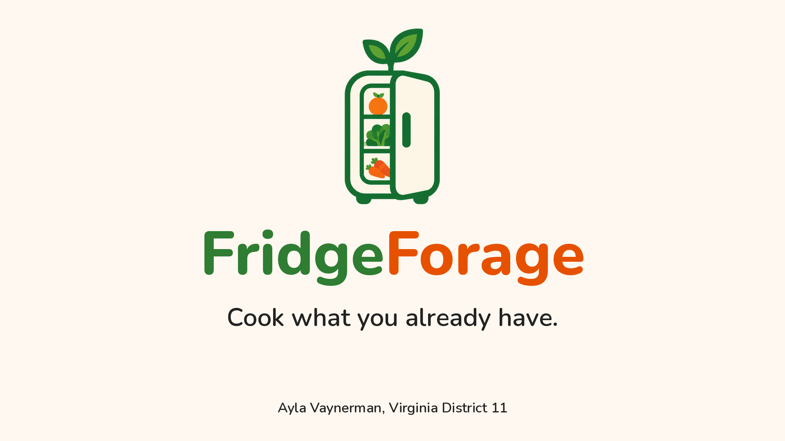
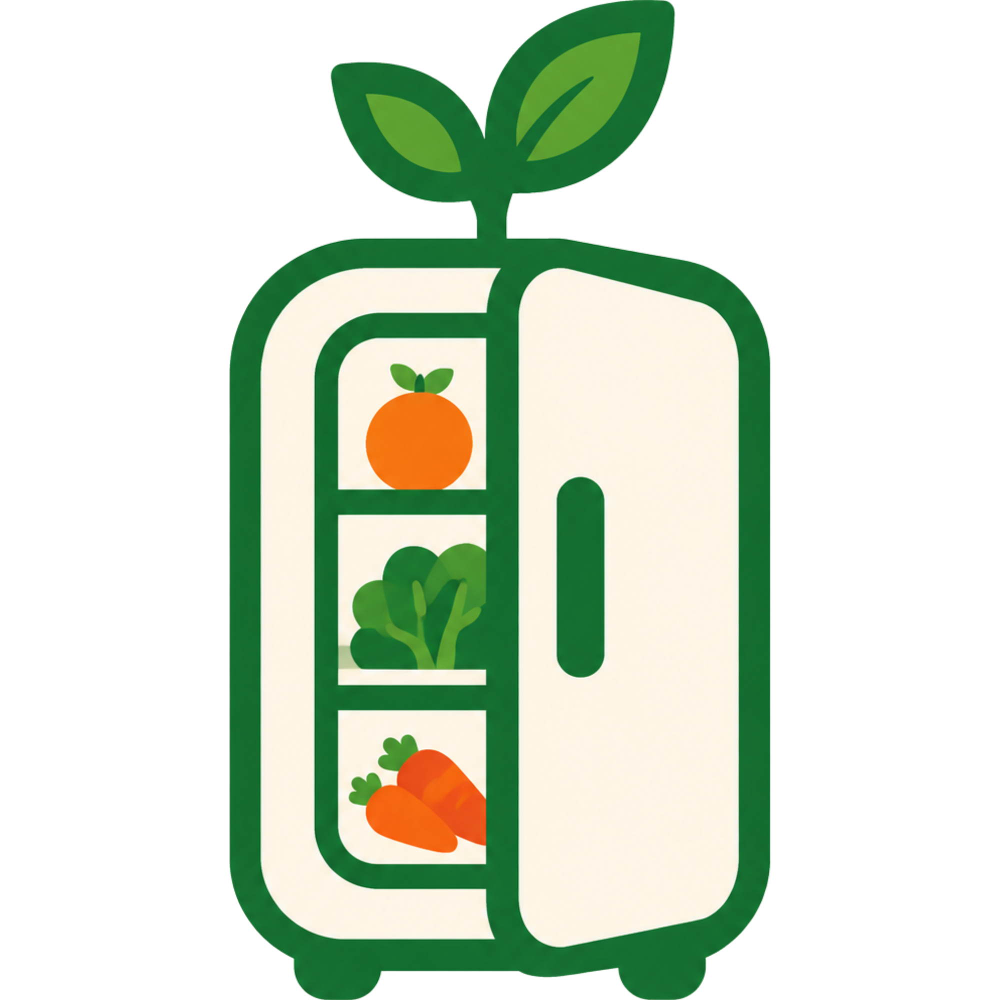

<p align="center">
  
</p>

# FridgeForage

**Cook what you already have.**

**Version 1.0.0** · October 26, 2026

FridgeForage is a mobile app that turns the ingredients in your fridge into dinner ideas. Add what you have, answer a quick quiz about what you're in the mood for, and get recipes ranked by how many of your ingredients they use. It helps cut food waste, save money, and answer the question "what should I cook?"

Built for the **Congressional App Challenge** by **Ayla Vaynerman, Virginia District 11**.

<p align="center">
  
</p>

## Features

- **Fridge list.** Add ingredients by name, with an optional photo taken from the phone's camera.
- **Perishable tracking.** Tap an ingredient to mark it perishable. Perishables get a "use soon" tag and move to the top of the list.
- **Saved on your device.** Your list is stored locally, so it's still there when you reopen the app. No account needed.
- **Recipe quiz.** Pick a kind of meal (such as Chicken, Dessert, or Vegetarian), a cuisine, and an optional word to look for in the recipe name.
- **Recipes ranked by your ingredients.** Results show a photo and how many of your ingredients each recipe uses.
- **Recipe details.** See the full instructions, with a green ✓ for ingredients you have and an orange ✗ for ones you're missing.
- **Measurement converter.** Convert between teaspoons, tablespoons, cups, fluid ounces, milliliters, liters, ounces, pounds, grams, and kilograms.

## How it works

1. For each ingredient in your fridge, the app asks [TheMealDB](https://www.themealdb.com/) for recipes that use it.
2. It combines the results and counts how many of your ingredients each recipe matches.
3. The quiz answers narrow the list by meal category, cuisine, and a keyword in the recipe name.
4. Recipes are sorted so the best matches appear first.

## Privacy

Your fridge list and photos stay on your device. The only thing sent over the internet is the names of your ingredients (and the quiz choices), which go to TheMealDB to look up recipes. The app has no accounts and no analytics.

## Built with

- [React Native](https://reactnative.dev/) and [Expo](https://expo.dev/) (SDK 57)
- [expo-image-picker](https://docs.expo.dev/versions/v57.0.0/sdk/imagepicker/) for the camera
- [AsyncStorage](https://react-native-async-storage.github.io/async-storage/) for saving data on the device
- [TheMealDB](https://www.themealdb.com/) for recipe data

## Run it yourself

You need [Node.js](https://nodejs.org/) and a phone with the **Expo Go** app (the version must support Expo SDK 57), or just a web browser.

```bash
git clone https://github.com/Hamstersarus/FridgeForage.git
cd FridgeForage
npm install
npx expo start
```

- **Phone:** scan the QR code with Expo Go (phone and computer on the same Wi-Fi). If it won't connect, use `npx expo start --tunnel`.
- **Browser:** press `w` in the terminal, or run `npx expo start --web`. The camera button opens a file picker on the web.

## Project layout

| File | What it does |
|---|---|
| `App.js` | The screens: fridge list, quiz, recipe details, and converter |
| `recipes.js` | Recipe search and filtering using TheMealDB |
| `convert.js` | Measurement conversion logic |
| `assets/` | Logo and images |

## Limitations and what's next

- Recipe variety is limited to what TheMealDB offers, and it matches ingredients by exact name, so "egg" and "eggs" can give different results.
- Ingredient photos are stored as temporary files and may stop appearing after a long time.
- Planned: a grocery list built from missing ingredients, a link to nearby stores, expiry dates, and a larger recipe source.
- The app uses TheMealDB's free test key, which is meant for development and educational use. A public app store release would need a supporter key or a different recipe source.

## Credits

- Recipe data: [TheMealDB](https://www.themealdb.com/)
- Created by Ayla Vaynerman
